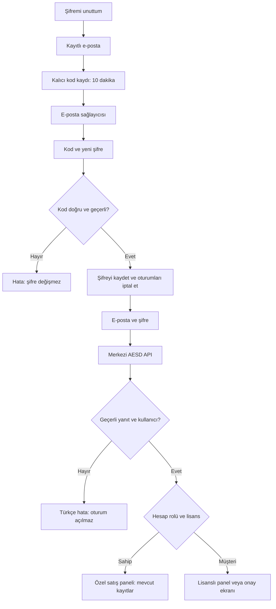

# AESD giriş ve şifre yenileme düzeltmesi

Tablet ekranındaki hata: Cannot read properties of undefined (reading 'role').
Uygulama giriş yanıtındaki kullanıcıyı doğrulamadan role alanını okuyordu. JSON olmayan veya eksik bir başarılı HTTP yanıtı da kabul edilebiliyordu. Canlı /aesd/v1/health 8 Ekim kontrolünde 404 döndü. Yeni uygulama API'si mevcut sunucuya kurulmamıştı. Ayrıca Android WebView https://localhost kökeni test sunucusu sanıldığı için APK istekleri cihazın kendi adresine gidiyordu. Bu seçim kaldırıldı. API adresi her zaman config.json dosyasından alınır; yerel test sunucusu kendi yapılandırmasını verir.

Uygulama JSON türünü, nesneyi, hata durumunu, kullanıcı rolünü, işyeri kapsamını, oturum belirtecini ve süresini denetler. Eksik yanıt giriş sayılmaz; şifre kaydedilmez. Hata Türkçe mesajla gösterilir.

Şifre yenileme /aesd/v1/password-reset/request ve confirm rotalarını kullanır. Kod sunucuda HMAC özetiyle tutulur. Süre 10 dakika; en fazla 5 yanlış kod; yeni istek için 60 saniye; saatlik istek sınırı vardır. Yeni kod eski kodu iptal eder. Kod kalıcı kayda yazılmadan gönderilmez. Gönderim kabul edilmezse kod iptal edilir ve başarı gösterilmez. Sağlayıcı kabulü gelen kutusu teslimatı değildir.

Şifre yenileme yalnız kodun ait olduğu hesabı değiştirir. Rol, işyeri, lisans, stok ve satış kayıtları korunur. Yeni şifre bcrypt ile saklanır. Sunucu oturumları iptal edilir; varsa eski JWT oturumlarının sürümü artırılır. Sahip özel panelinin cihazdaki güvenlik şifresi ayrıdır ve değiştirilmez. Destek e-postası girilerek OWNER yetkisi alınamaz.

English technical notes follow ASD-STE100 writing principles.
The client checks the server response before it reads the user role.
The server saves the code hash before it sends the message.
The code expires after ten minutes.
A successful reset revokes the account sessions.
The reset does not change the account role or sale records.
Provider acceptance does not confirm delivery to the inbox.
The tests do not confirm operation on an Android device.
This report does not claim formal ASD-STE100 certification.

Canlı kod isteği zaman aşımına uğradı ve kullanıcı mail gelmediğini belirtti. Yeni kurtarma akışı eski Render kurtarmasının Gmail HTTPS seçim kuralını kullanmıyordu. recoveryProvider bu kuralı yeni akışa uygular. SMTP için bağlantı ve soket bekleme sınırları eklendi. Sağlık yanıtı seçilen e-posta sağlayıcısını ve yapılandırma durumunu açıklar; teslimi doğrulamaz.

8 Ekim son doğrulama: Gmail HTTPS kod isteği 200 döndü. Kullanıcı yeni kodun e-postaya ulaştığını açıkça teyit etti. Gerçek e-posta teslimatı doğrulandı. Kullanıcının kendi hesabında şifre yenilemesi ve giriş yapması ayrı sonuç olarak beklenir. Android cihaz üzerinde kabul testi yapılmadı.

Elinde geçerli kod varsa: Şifremi unuttum → Kayıtlı e-posta → Kodum var → Kod ve yeni şifre. Yeni kod istemeden mevcut kod kullanılabilir.
