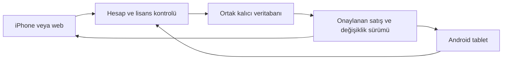

> Uygulama durumu: ortak kayıt kodu eklendi. Son kullanım ve sınırlar için CLOUD-SYNC-RELEASE.md dosyasını oku. Aşağıdaki metin başlangıç planıdır.

# AESD — iPhone ve tablet arasında ortak kayıt

Durum: Tasarım planıdır. Bulut eşitlemesi henüz uygulanmadı. Mevcut APK ve canlı sunucu bu belge oluşturulurken değiştirilmedi.

## İncelenen mevcut yapı

Satış, ürün, alış, stok, cari ve adisyon verileri cihazdaki IndexedDB içinde tutulur. Yeni paneller schema 2, özel panel version 3 biçimini kullanır. Merkezî API kullanıcı, lisans ve izin verilmiş ciro özetlerini saklar. Sunucuda PostgreSQL bağlantısı ve SQLite snapshot kalıcılığı vardır. Bu bağlantı ortak satış verisini henüz taşımıyor.

## Önerilen ilk sürüm

Mevcut kalıcı PostgreSQL bağlantısına işyeri ve panel bazında satış, satış satırı, stok hareketi, alış, cari hareketi, ürün ve adisyon kayıtları eklenir. Mevcut hesaplar, şifreler ve lisans kayıtları korunur. Yeni domain satın almak eşitlemenin ön koşulu değildir.

Sunucu her istekte hesabı, işyerini, panel hakkını ve cihaz yetkisini denetler. Sahip kendi dört panelini kullanır. Müşteri lisansları eşitleme nedeniyle aşılmaz. Birden fazla müşteri cihazı açılacaksa lisansın cihaz kuralı ayrıca açıkça tanımlanır. Yönetici lisans paneli müşterilerin ayrıntılı satış kayıtlarına otomatik erişim kazanmaz; mevcut rızaya bağlı ciro özeti kuralı korunur.

İlk ortak satış sürümünde satışın kesinleşmesi için sunucu onayı gerekir. İşlem kimliği cihazda kalıcı üretilir. Satış, stok ve cari güncellemesi tek veritabanı işleminde yapılır. Tekrar gönderilen aynı kimlik ikinci satış veya stok düşümü oluşturmaz. Stok eşzamanlı işlemde sunucuda kilitlenerek denetlenir. Sunucuya kaydedilmeyen işlem başarılı satış olarak gösterilmez. Yanıt kaybolursa işlem kimliği sorgulanır; yeni satış oluşturulmaz.

Diğer cihaz, aynı işyeri ve panel için sunucudan yeni değişiklikleri alır. Odaklanma, bağlantı geri gelmesi ve kısa aralıklarla kontrol edilen değişiklik sürümü üzerinden güncellenir. Ekranda son eşitleme zamanı ve bağlantı durumu görünür. Aktif sepet, ödeme seçimi ve ürün arama odağı yenileme sırasında korunur.

Özel panelde yalnız çiğköfte hamuru stoktan düşer. Diğer malzemeler ürün maliyetine katılır. Market ve diğer gıda panellerinin kendi stok kuralları korunur. Yeni alış geçmiş satış maliyetini değiştirmez. İptal özgün satışın stok ve cari hareketini geri alır.

## İlk veri aktarımı

Android tabletteki mevcut gerçek kayıtlar bu çalışma ortamında bulunmuyor. İlk aktarım uygulamadaki yedek/aktarım akışıyla yapılmalıdır. Her panel ayrı aktarılır. Sunucu biçimi, işyeri kimliğini, maliyetleri, stok ve cari bakiyesini doğrular. Aktarım öncesi yedek tutulur; aktarım özeti ürün/satış sayısı ve bakiyeleri gösterir. İki cihazda aynı kimlikle farklı kayıt varsa sessizce üzerine yazılmaz. Sorun çözülmeden bulut sürümü mevcut kayıtları değiştirmez. Aynı yedeği tekrar yüklemek kayıtları çoğaltmaz.

## Çevrimdışı kullanım

Mevcut yerel çalışma ile yeni ortak satış modu ayrı açıklanmalıdır. Birden fazla çevrimdışı cihazın aynı stoku kesin olarak ayırması mümkün değildir. Kontrollü çevrimdışı satış ikinci aşamadır: kalıcı gönderim kuyruğu, doğrulanmış maliyet sürümü, bekleyen/çatışan işlem durumu ve stok uyuşmazlığını çözme akışı gerekir. Çevrimdışı kayıt otomatik olarak sunucu tarafından onaylanmış kabul edilmez.

## Süreklilik ve doğrulama

Ücretsiz Render hizmeti uyuyabilir. Eşitleme mevcut hizmette hazırlanabilir. Uykuya geçmeyen plana geçiş ücretlidir ve ayrıca maliyet kararı gerektirir. Ücretli hizmette de bakım veya bağlantı kesintisi olabilir. Günlük yedek ve yedeği geri yükleme denemesi ayrı doğrulanmalıdır.

Testler iki bağımsız istemciyle satış, çift istek, yanıt kaybı, eşzamanlı son stok, cari tahsilat, iptal, yeniden açılış, başka işyerinin verisine erişim ve ilk aktarım senaryolarını kapsar. Özel panel maliyet/hamur kuralları yeniden çalıştırılır. Gerçek Safari/iPhone ve Android tablet sonuçları tarayıcı otomasyonundan ayrı raporlanır.

## İşlem şeması

## ASD-STE100 yazım ilkeleriyle teknik özet

The server stores each sale for its business and panel.
The server checks the account and device before it accepts a sale.
Each operation has one permanent ID.
A repeated operation does not create a second sale.
The server updates the sale, stock and account balance in one transaction.
The client reports success after the server confirms the transaction.
The migration retains past sale costs.
The tests must check both devices separately.

Bu belge kısa cümle, etken anlatım ve tutarlı terimler kullanır. Resmî ASD-STE100 uygunluk sertifikası iddia etmez.
