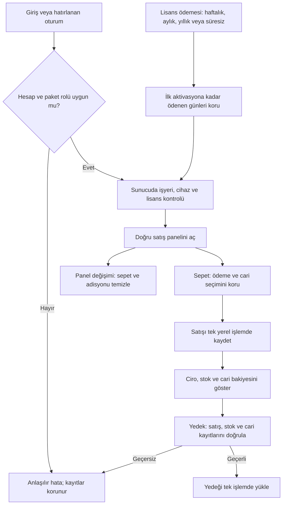

# AESD 1.5.1 son inceleme

Bu turda testlerle doğrulanan hatalar düzeltildi. Kusursuzluk veya resmî ASD-STE100 uygunluğu iddia edilmez. İngilizce teknik metinlerde kısa cümle, etken anlatım ve tutarlı terimler kullanılır.

| Alan | Hata | Düzeltme |
|---|---|---|
| Hesap kaydı | bcrypt, 72 UTF-8 baytından sonraki şifreyi kesiyordu. | Yeni kayıtta ve şifre yenilemede 72 bayt sınırı uygulanır. Eski hesaplar sıfırlanmaz. |
| Lisans | İlk aktivasyondan önce uzatılan paket önceki günleri kaybediyordu. | Ödenen günler birikir. 7 gün + 30 gün, ilk aktivasyonda 37 gündür. Mevcut lisanslar veri kaybı olmadan taşınır. |
| Yedek | Eksik, yinelenmiş veya değiştirilmiş stok hareketi iptalde stok şişirebiliyordu. | Hareketler satış satırlarıyla, stok bakiyesi alış ve satış kayıtlarıyla eşleşmelidir. |
| Yedek | Kayıt kimliğine HTML eklenebiliyor ve aynı barkod tekrarlanabiliyordu. | Kimlik, metin, tutar, tarih, reçete ve barkod denetlenir. Bozuk yedek mevcut kayıtları değiştirmez. |
| Sepet | Panel değişince eski ürünler ve adisyon sepette kalabiliyordu. | Sepet, adisyon, ödeme ve cari seçimi yeni işyeri/panel için temizlenir. |
| Ödeme | Ürün ekleme ödeme ve cari seçimini sıfırlıyordu. | Seçimler sepet değişirken korunur; satış tamamlanınca temizlenir. |
| Barkod | Okutma sonrası alan odağı kayboluyordu. | Bir sonraki okutma için alan odağı korunur. |
| Toplam | Kesirli miktarda sepet toplamı kayıtlı satış toplamından farklı olabiliyordu. | Toplam, kuruşa yuvarlanan satır tutarlarından hesaplanır. |
| Oturum | Geciken yenileme yanıtı çıkıştan sonra eski ekranı açabiliyordu. | Oturum/panel değişiminden önce başlayan yanıt kullanılmaz. Özet gönderimi de aynı kapsamı kontrol eder. |
| Paket | Hatırlanan hesap açılışında sahip/müşteri paket ayrımı kontrol edilmiyordu. | Yanlış rol, API çağrısından önce reddedilir. Sunucu yetki kontrolü ayrıca sürer. |

Yeni panellerin ürün reçeteleri şu anda oluşturulduktan sonra değiştirilemez. Yedek doğrulaması bu kurala dayanır. Gelecekte reçete düzenleme eklenirse geçmiş stok hareketlerinin reçete sürümü ayrıca saklanmalıdır. Eski özel panelin kayıt biçimi ve yedekleri değiştirilmedi.

The application keeps the payment selection when the basket changes.
The application clears the basket when the business or panel changes.
The server retains all purchased days before the first activation.
The application rejects a backup if its stock records do not agree.
A rejected backup does not change the saved records.
The application ignores a response from an earlier session.
The tests use sample accounts and isolated mail responses.
The tests do not confirm operation on an Android device.
The recipient confirmed Gmail delivery in the previous test.
The recipient has not confirmed a password reset and login on the tablet.

Android emülatörü, adb, bağlı cihaz ve /dev/kvm mevcut değil. Gerçek Android kurulum/güncelleme, zorla kapatma, kamera, fiziksel barkod okuyucu ve native dosya paylaşımı test edilmedi. Tarayıcı testleri Android testi sayılmaz. SMS sağlayıcısı bağlı değil. Ödeme onayı satıcının manuel işlemidir; ödeme sağlayıcısı bağlanmadı. Domain henüz satın alınmadı. Çevrimdışı lisans kapatma en fazla bir saat gecikebilir. JSON yedekler şifrelenmez.

## Sunucu bağımlılık taraması

Tarama öncesi sonuç: 2 kritik ve 1 yüksek seviyeli bağımlılık bildirimi. express bildirimi proxy-addr paketinden kaynaklanıyordu. nodemailer 10.0.16 sürümüne güncellendi; proxy-addr 2.0.8 sürümüne sabitlendi. package-lock.json güncellendi. SMTP aktarımında dosya ve URL okuma kapatıldı. Son npm audit sonucunda bilinen açık sayısı sıfırdır. Bu, sunucunun JavaScript bağımlılık taramasıdır; Android native bağımlılıklarının tam incelemesi değildir. Gerçek SMTP teslimatı bu turda yapılmadı. Güncel e-posta paketi ağ bağlantısı kullanmadan ileti oluşturma ve yasak dosya erişimi testlerinden geçti. Gmail HTTPS sağlayıcısı ve kurtarma testleri yeniden doğrulandı.

The dependency scan reported no known vulnerabilities after the update.
The result applies to the server JavaScript dependencies.
The mail transport does not read local files or remote attachments.
The isolated message test does not confirm SMTP delivery.
