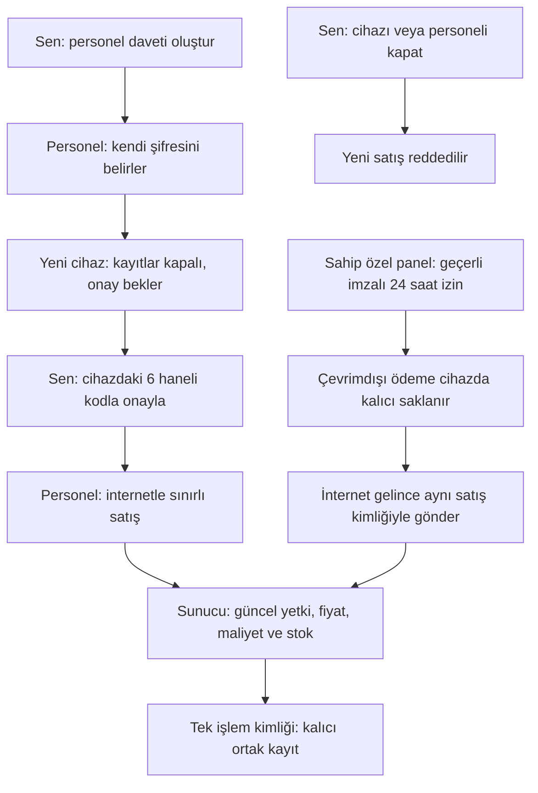

# AESD APK ve web son incelemesi — 9 Ekim 2026

Bu inceleme sahip APK’sını, müşteri APK’sını, web satış panellerini, personel cihaz onayını, sunucu yetkisini ve satış kayıtlarını kapsar. Bulunan hatalar kaynakta düzeltildi. Sonuçlar yeni test loglarından ve son dağıtım/paket kanıtından okunur. Önceki turların sonuçları bu turun başarı sayısına eklenmez.

Bu belge gerçek cihaz kabulü veya kusursuzluk sertifikası vermez. İngilizce teknik notlarda ASD-STE100 kısa cümle, açık fiil ve tutarlı terim ilkeleri kullanıldı. Bunlar kodlama kuralları veya resmî uygunluk belgesi değildir.

## Hata ve düzeltme

| Sorun | Son davranış | Yeni doğrulama |
| --- | --- | --- |
| Yetki reddinden sonra ekranda eski kayıtlar kalabiliyordu. | Doğrulanmış 401/403 yanıtı kayıtları gizler, eski özel paneli ve açık pencereleri kapatır. Geciken yanıt erişimi geri getirmez. Kalıcı satış kuyruğu silinmez. | `tests/auth-denial-ui.test.mjs`, `tests/staff-ui.test.mjs` |
| Okunamayan JSON olmayan 4xx yanıtı ödeme sonucunu kesinleştiremiyordu. | Yanıt belirsiz sayılır. Aynı satış kimliği ve bekleyen işlem korunur. Önce makbuz kontrol edilir; aynı satış tekrar yazılmaz. | `tests/cloud-pending.test.mjs`, `tests/private-offline.test.mjs`, `tests/staff-ui.test.mjs` ve ana test logundaki ilgili sonuçlar |
| Lisans, hesap veya şifre değişimi bekleyen satışla yarışabiliyordu. | Sunucu erişim değişikliklerini ve satışları aynı sırada yürütür. Beklemelerden sonra oturumu ve veritabanındaki güncel rolü yeniden kontrol eder. Kapatma tamamlandıktan sonraki yeni satış reddedilir. Daha önce sıraya giren geçerli işlem tamamlanabilir. | `tests/cloud-authority.test.mjs`, `tests/legacy-control.test.mjs` |
| APK yeni yerel bağımlılıklardan bazılarını içermeyebilirdi. | Paketleyici yerel bağlantıları ve dolaylı modülleri kontrol eder. Eksik dosya paketi durdurur. Sahip ve müşteri kaynakları ayrı kalır. | `evidence/apk-packaging-tests.txt`, `evidence/apk-source-check.json`, `evidence/build.json` |
| Eski sunucu dağıtımı güncel APK için kanıt sayılabilirdi. | APK manifesti taze LIVE commit ve kaynak özetleriyle eşleşir. Eski sağlık kaydı, farklı commit veya değişmiş kaynak güncel kanıt değildir. | `evidence/full-review-live.json`, `evidence/build.json` ve rapor üreticisindeki dosya denetimi |

Satış kuralları korunur. Sahip özel panelinde yalnız çiğköfte hamuru stoktan düşer. Diğer malzemeler ürün maliyetine girer. Yeni alış geçmiş satış maliyetini değiştirmez. İptal özgün stok hareketini geri alır. Market ürün stokunu; Restoran ve Kafe malzeme reçetesini kullanır.

## Bu turun test sonuçları

Kesin başarılı sayılar rapor üretilirken aşağıdaki yeni logların son özetinden alınır. Dokümana sabit bir eski sayı yazılmaz. `make-full-review.py` başarısız, eksik veya yarım test özetiyle rapor üretmez.

| Grup | Güncel kanıt | Sayı kaynağı |
| --- | --- | --- |
| Ana kaynak, erişim ve yalıtılmış DOM testleri | `evidence/full-review-unit.tap` | Son `tests`, `pass`, `fail`, `skipped`, `todo` özeti |
| Özel panel regresyonları | `evidence/full-review-private.tap` | Son TAP özeti |
| Yalıtılmış kurtarma sağlayıcısı · açıkça seçilmiş `node:sqlite` test bağdaştırıcısı | `evidence/full-review-recovery.tap` | Son TAP özeti; native SQLite kabul sonucu değildir |
| Python APK paketleme ve dağıtım kanıtı denetimi | `evidence/apk-packaging-tests.txt` | Son `Ran … tests` ve `OK` sonucu |

Üretilen PDF’de her grup ayrı gösterilir. Toplam yalnız geçen otomatik testleri içerir. `evidence/full-review-report.json` aynı sayıları ve rapor dosyasının özetini içerir. Kaynak/DOM testlerine “tarayıcı ekran kontrolü” denmez.

Kurtarma testlerinin native `better-sqlite3` denemesi bu Node 24 test makinesinde dört ilk kontrolün ardından `RemoveEnvironmentCleanupHook` assertion ile durdu. Bu tamamlanmamış deneme toplam başarıya eklenmedi. Kanıt `evidence/full-review-recovery-native-failed.tap` dosyasında korundu. Aynı yalıtılmış test grubu açıkça seçilmiş `node:sqlite` bağdaştırıcısıyla yeniden tamamlandı. Bu test ortamı hatası üretim veya Android uygulamasının çöktüğü anlamına gelmez; bu ortamda native SQLite çalışmasını doğrulamaz.

Bu tur gerçek Chromium sayfa açmadan durdu: `setsockopt: Operation not permitted`, ardından `SIGTRAP`. Yeni ekran görüntüsü ve piksel yerleşimi kontrolü yoktur. Native SQLite HTTP denemesi yerel TCP dinlemesinde `listen EPERM 127.0.0.1` ile engellendi; bu tur başarılı sayılmaz. Kanıtlar `evidence/final-runtime-check.json`, `evidence/final-browser-launch.log` ve `evidence/full-review-native.tap` dosyalarındadır.

Gerçek Android veya iPhone cihazı çalıştırılmadı. Emülatör, adb ve `/dev/kvm` yoktur. Kurulum, uygulamayı kaldırmadan güncelleme, zorla kapatma, yeniden açılış, kamera, fiziksel barkod okuyucu ve native yedek paylaşımı cihazda kabul edilmedi. Yeni üretim HTTP/PostgreSQL ağ kabulü bu tur doğrulanmadı. Render LIVE sonucu gerçek satış kabul testinin yerine geçmez.

## Paket ve dağıtım kanıtı

Gerçek paketleyici manifesti `evidence/build.json` dosyasıdır; bir dizi içinde sahip ve müşteri APK kaydı vardır. Her kayıtta dosya SHA-256 özeti, paket adı, sürüm kodu, özgün sertifika, imza şemaları, hizalama, varlık özetleri ve son sunucu commit’i bulunur. Rapor bunları mevcut APK dosyalarına karşı yeniden okur. Manifesti veya `validation.json` dosyasını değiştirmez.

Sahip: `com.oses.pos`, sürüm kodu `151`, özgün imza korunur. Mevcut uygulamayı silmeden güncelle. Müşteri: `com.aesd.pos`, sürüm kodu `151`; sahip özel paneli ve personel giriş kaynağı bu pakette bulunmaz. Sahip APK’sı personel yönetimi ekranını içerir; personel kendi web linkini kullanır.

`evidence/full-review-template-match.json`, kanonik özel panelin sunucu dönüşümüyle paketlenen kaynağın eşleşmesini gösterir. Rapor kaynak özetini paketlenmiş HTML ile karşılaştırır. Güncel canlı commit, dağıtım kimliği ve kontrol zamanı `evidence/full-review-live.json` dosyasından alınır. Rapor eski dağıtım bilgisini güncelmiş gibi kullanmaz.

Web: https://aesd-server.onrender.com/aesd/

Personel: https://aesd-server.onrender.com/aesd/staff.html

Mevcut ücretsiz Render hizmeti uyuyabilir. Domain satın alınmadı. Gerçek kullanıcı tablet verileri bu ortamda incelenmedi; güncellemenin gerçek kayıtlarla kabulü ayrı iştir.

## Senin kontrolün ve personel akışı

Sahip girişiyle Ayarlar → Personel ve Cihaz Onayı bölümünü aç. Tek kullanımlık davet oluştur. Davet 24 saat geçerlidir. Personel kendi şifresini belirler. İlk cihaz da onay bekler. Personelin cihazında görünen 6 haneli kodla doğru isteği onayla. Cihazı veya personelin bütün erişimini kapatabilirsin.

Linkin başkasına iletilmesini doğrudan göremeyiz. Başka cihazda personel girişi yapılırsa yeni onay isteği görünür. Yönetici şifresi sende kalır. Cihaz kimliği tarayıcı kaydıdır; fiziksel donanım doğrulaması iddia edilmez.

Personel günlük/aylık net ciro, ürünler ve sepeti görür. Nakit, Kart ve Diğer ödeme kaydı yapar. Personel stok, lisans, yönetici ayarı veya geçmiş satış iptali değiştiremez. Kart düğmesi banka tahsilatı yapmaz; dış POS ile alınan ödemeyi kaydeder.

Personel satışında internet gerekir. Sahip özel paneli, önceden alınmış geçerli imzalı izinle en fazla 24 saat yeni çevrimdışı ödeme saklar. Kalıcı cihaz yazımı tamamlanmadan başarı göstermez. Bağlantı gelince aynı işlem kimliğiyle gönderir. İzin biterse yeni çevrimdışı ödeme durur; kaydedilmiş bekleyen satış korunur. Alış, iptal ve ayarlar internet ister.

## Görsel ve açık sınırlar

`artifacts/AESD-GUNCEL-KONTROL-SEMASI.png` ve `.svg` işleyişi gösteren şemadır. `artifacts/AESD-GUNCEL-KONTROL-TEMSILI.png` tasarımı açıklayan üretilmiş görseldir. Bunlar yeni gerçek tarayıcı veya cihaz ekran görüntüsü değildir. PDF’de bu ayrım açıkça yazılır.

Bu tur gerçek Gmail teslimatı tekrar test edilmedi. Önceki ayrı gönderimde alıcı e-postanın geldiğini teyit etmişti; bu tarihsel kanıttır. Kendi hesabında şifre yenileme ve giriş ayrı kabul işlemidir. SMS ve banka ödeme sağlayıcısı bağlı değildir.

Bekleyen satış varken uygulamayı veya tarayıcı verisini silme. Kuyruk yedeği şifreli değildir; otomatik geri yükleme ekranı yoktur. Ortak JSON kayıt sınırı 16 MB, sahip bekleyen satış sınırı 500 kayıttır. Doritos maliyeti için gerçek alış fiyatı girilmelidir; eksik maliyet uydurulmadı.

## English technical notes

The server reads the current account role from the database.

The server runs access changes and sales in one queue.

The application hides shop records after a confirmed access denial.

An unreadable response does not cancel a pending sale.

The application keeps the same sale ID when it checks the receipt.

A repeat request does not create a second sale.

A new purchase does not change a past sale cost.

The APK check fails if a required local file is missing.

The report separates a live deployment from an HTTP acceptance test.

The tests use sample records. Physical device tests are not complete.

## Raporu yeniden üretme

Son dört test grubu, yeni LIVE kaydı, APK derlemesi ve şablon kanıtı tamamlandıktan sonra proje kökünde `python make-full-review.py` çalıştırılır. Çıktılar:

- `artifacts/AESD-SON-KONTROL-RAPORU.pdf`
- `evidence/full-review-report.json`

Üretici uygulama kaynağını, `validation.json` veya `evidence/build.json` dosyasını değiştirmez. Eksik test, başarısız test, farklı kaynak veya APK özeti ve eski LIVE kontrolü raporu durdurur.
