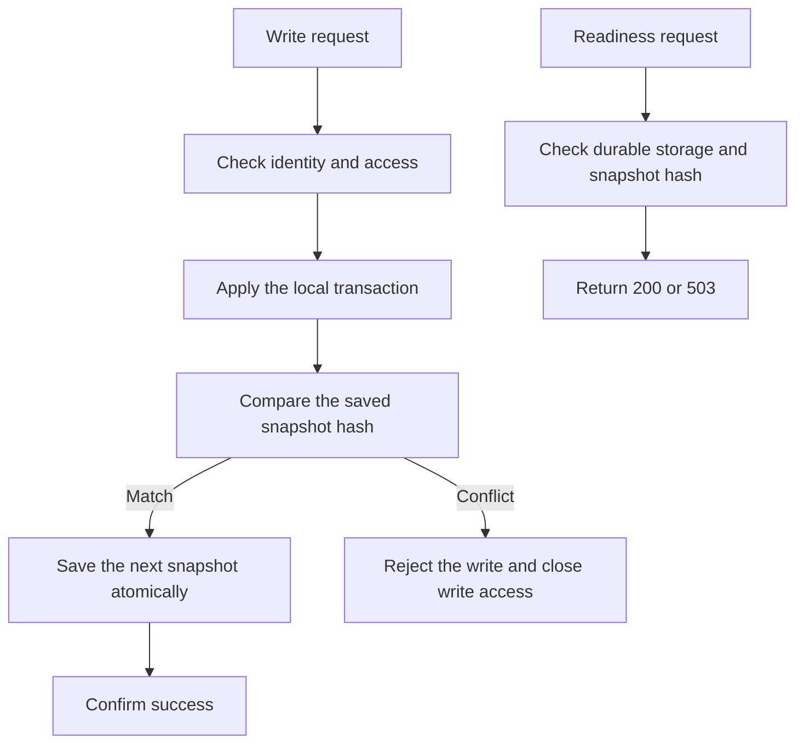

# Server 1.0.3 module release

This release uses short technical sentences based on ASD-STE100 principles.
It does not claim formal compliance or fault-free software.

| Module | Change or check | Result |
| --- | --- | --- |
| Identity and recovery | Check passwords, expired codes, repeat codes and session revocation. | Recovery and isolated mail checks pass. |
| Snapshot storage | Add `snapshot-write.js`. Compare the prior hash in the database write. Reject a stale writer, a duplicate first writer and a deleted snapshot. | Real PostgreSQL tests pass. |
| Storage recovery | Keep a failed writer closed. Restore the current snapshot on restart. | Restart tests keep the newer license value. |
| Health | Add `health.js`. Return 503 after a storage failure. Add `/ready` to probe storage and detect a stale snapshot. | HTTP tests pass. |
| Native SQLite | Pin better-sqlite3 12.11.1. It supports Node 20, 22 and 24. The old driver aborted during Node 24 cleanup. | Native HTTP and recovery tests pass. |
| Sales and staff | Check access, stock limits, operation receipts and tenant scope. | 172 platform tests pass. |
| Private panel | Check retained history, costs, cancellation and repeat operations. | 5 private tests pass. |
| Shared PostgreSQL | Wait for the restored UI state in the test fixture. Check stock races, JSONB order and immutable past sales. | 7 tests pass. |
| Delivery | Add module CI checks. Keep source and test evidence separate. | Publication evidence is recorded after deployment. |

## Validation

- 21 server tests pass. These include real PostgreSQL snapshot tests.
- 172 platform tests, 5 private tests and 1 native HTTP test pass.
- 7 shared PostgreSQL tests pass.
- The standalone email test passes with isolated durable storage and mocked mail.
- Six Chromium groups pass. Their result files record 92 checks.

The first broad checks exposed an old SQLite cleanup failure and a test fixture
that read the UI before restore completed. Both were corrected and retested.

## Operations

The production service currently has one instance. Keep one instance for the
SQLite snapshot design. Hash comparison prevents a stale writer from replacing
newer data. It does not provide shared, current reads across several instances.
A normalized PostgreSQL identity store remains a separate migration project.
No database schema migration is required for this release.

Use `/ready` when the monitor must check durable storage. `/health` reports the
process storage state. It does not issue a database query on every request.
A failed or stale writer must restart from the current durable snapshot.
Do not deploy an older unconditional snapshot writer beside this release.

Keep the current Render service, database, secrets and account IDs.
Keep the POS APKs at 1.5.2. This release changes the backend, not their assets.
No new APK is built. No real email, payment or physical device acceptance is claimed.
