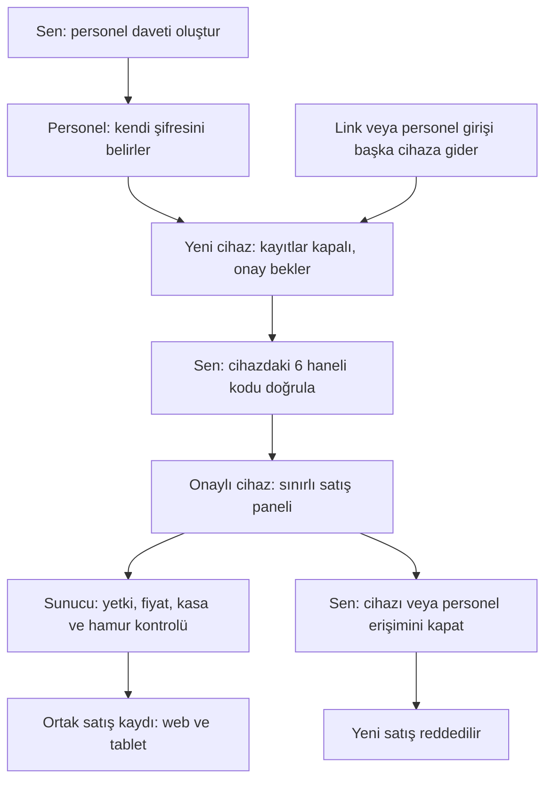

# Personel ve cihaz onayı — 9 Ekim 2026

Bu değişiklik sahibin özel dükkân paneli için ayrı web personel erişimi ekler. Yönetici hesabı ve şifresi personelle paylaşılmaz. Market, Restoran ve Kafe müşteri lisansları aynı kalır.

## Kullanım

1. Sahip hesabınla https://aesd-server.onrender.com/aesd/ adresine gir. Ayarlar → Personel ve Cihaz Onayı bölümünü aç.
2. “Kardeşim” veya personelin adıyla tek kullanımlık davet oluştur. Ekrandaki personel linkini ve davet kodunu kendin paylaş. Kod 24 saat geçerlidir; bir kez kullanılabilir.
3. Personel https://aesd-server.onrender.com/aesd/staff.html adresini Safari ile açar. “Davet kodum var” seçeneğinde kodu kullanır ve kendi şifresini belirler.
4. İlk cihaz da onay bekler. Personel ekranındaki 6 haneli kodu sana söyler. Kendi panelinde doğru personel ve cihaz isteğini bul, kodu gir ve onayla.
5. Personel giriş adını saklar. Sonraki girişlerde bu adı ve kendi şifresini kullanır. Yeni telefon veya tarayıcı ayrı onay bekler. Tarayıcı verileri silinirse cihaz kimliği değişebilir; tekrar onay gerekir.
6. “Bu Cihazı Kapat” yalnız seçilen cihazı durdurur. “Personel Erişimini Kapat” o personelin bütün cihazlarını durdurur. Tekrar açma yetkisi sahibindir.

## Yetki sınırı

Personel aktif ürünleri, fiyatlarını ve günlük/aylık net ciro toplamlarını görür. Nakit, Kart ve Diğer ödeme kayıtlarıyla satış yapar. Kart seçimi bankadan tahsilat yapmaz; dış POS ile alınan ödemeyi kaydeder. Kasa sahibi tarafından açılmış olmalıdır.

Personel lisansları ve yönetici ayarlarını değiştiremez. Müşteri listesi, maliyet reçeteleri, stok miktarları, ayrıntılı satış geçmişi ve özel panelin tam kaynak sayfası personel oturumuna verilmez. Stok düzenleme, geçmiş satış iptali, veresiye, indirim ve yedek geri yükleme bu personel ekranına eklenmedi.

Personel satışı internet ve güncel sunucu erişim onayı gerektirir. Sahip özel panelinin mevcut imzalı çevrimdışı satış kuyruğu korunur. Personel için çevrimdışı kullanım izni üretilmez. Satış sonucu bağlantıda kaybolursa işlem kimliği ve sepet cihazda kalır. Uygulama aynı satışı arar; sunucudan doğrulama gelmeden başarılı demez.

Bu turda yeni APK oluşturulmadı. Yeni personel yönetimi web sahip panelindedir. Önceki APK dosyaları bu yeni ekranları içermez.

## Bilgin nasıl olur?

Bağlantıyı başkasına iletme eylemi izlenemez. Yeni personel cihazı giriş yapınca onay isteği ve denetim kaydı oluşur. Açık sahip web paneli hesabı yaklaşık 45 saniyede bir yeniler; yeni isteği bildirim ve bekleyen cihaz sayısıyla gösterir. İstek listesi “İstekleri Güncelle” ile de yenilenir. Bu turda e-posta veya telefon anlık bildirimi eklenmedi.

Link tek başına dükkân kayıtlarını açmaz. Personel şifresi başka cihazda kullanılsa da yeni cihaz onay bekler. Yönetici hesabının şifresi bu sınırlı erişimin dışında tam sahip yetkisi verir; sende kalmalıdır. Cihaz kimliği tarayıcı kaydıdır. Donanım doğrulaması veya tarayıcı depolamasının kopyalanmasını fiziksel olarak engelleme iddiası yoktur.

## Sunucu ve kayıt

Personel davetleri, cihaz durumları ve oturumlar ayrı SQLite kontrol tablolarında saklanır. Ham davet kodu, şifre ve oturum anahtarı listeye girmez. Davet kodu ve oturum anahtarı özetlenir. Üretimde şifre mevcut bcrypt sağlayıcısıyla saklanır. Oturum cihaz kimliğine bağlıdır. Normal oturum 8 saat, “Beni Hatırla” 14 gündür. Her satışta süre, hesap ve cihaz durumu tekrar kontrol edilir.

Personel anahtarı sahip oturumu olarak kullanılamaz. Yetki kontrolü arayüzdeki düğmelerle sınırlı değildir. Onay/kapatma işlemleri kalıcı kontrol kaydı yazımını bekler. Depolama hatası başarı sayılmaz ve yeni yetki işlemleri durur.

Satış fiyatı, maliyeti ve hamur ihtiyacı sunucudaki güncel ortak kayıttan hesaplanır. Yalnız hamur stoktan düşer. Diğer reçete malzemeleri maliyete katılır. Yeni alış geçmiş satış maliyetini değiştirmez. Satış, stok, kasa ve işlem makbuzu tek PostgreSQL işlemiyle kaydedilir. Aynı işlem kimliği tekrar gelirse ikinci satış oluşmaz. Aynı kimlikle farklı satış 409 alır.

Kapatılmış cihaz yeni satış yapamaz. Daha önce gönderilmiş kendi satışının sonucunu doğrulayabilir. Bu kontrol yeni dükkân verilerine erişim sağlamaz. Süresi dolmuş oturum tekrar personel girişi ister; yerel bekleyen işlem silinmez.

## Test kapsamı

127 ana test ve 61 özel panel regresyonu geçti: toplam 188. Ana testlerin 24'ü bu yeni personel yetkisi, satış, yeniden açılış, API yönlendirme ve DOM akışlarını kontrol eder.

Kontroller: kullanılmamış/süresi dolmuş davet, ilk ve ikinci cihazda onay, yanlış kod, başka sahip, sahte fiyat/miktar/ödeme, sahip uçlarına erişim reddi, kapatma, oturum süresi, kalıcı depolama hatası, son hamur stokunda iki cihaz yarışı, geçmiş maliyet, kayıp satış yanıtı ve iki sekmede bekleyen ödeme. Gerçek personel JavaScript kodu yalıtılmış DOM'da giriş → onay → satış → kapatma akışıyla çalıştırıldı. Onay/kapatma kayıtları veritabanı yeniden açılışında korundu.

Kanıtlar `evidence/staff-*` dosyalarındadır. API yönlendirme testleri sunucu işleyicilerini yalıtılmış isteklerle çağırır; üretim HTTP testi değildir. DOM kontrolleri piksel yerleşimi, gerçek Safari veya Android kabul testi değildir. Bu turda gerçek iPhone, tablet, banka, Gmail ve SMS testi yapılmadı. Önceki Gmail teslimat teyidi ayrı bir kanıttır. Bu belge kusursuzluk veya resmî ASD-STE100 uygunluk sertifikası vermez.

## English technical notes

The owner creates a staff invitation.
The staff member sets a separate password.
Each new browser needs owner approval.
The server checks access before each sale.
The server calculates the price and cost.
Only dough stock decreases during a sale.
A new purchase does not change a past sale cost.
The server stores one sale for each operation ID.
A lost response does not create a second sale.
Staff sales need an internet connection.
The tests do not confirm operation on a physical iPhone.
